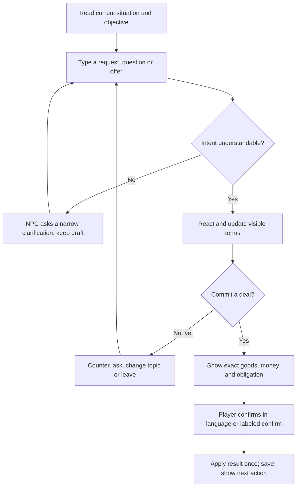

# Silver Tongue: a playable first-town conversation flow

2026-10-14 · Design and conversation-flow plan. Implementation follow-up on 2026-10-15: a separate local playable merchant-town experiment now exists; see [the experiment runbook](../../merchant-town-experiment.md). The original course remains the baseline reviewed below.

## What this should feel like

You wake in somebody else's room, cannot explain yourself, and make a friend who needs your language as much as you need his. You learn enough to get food, correct a bad transaction, and become useful to the neighborhood. A visiting merchant offers a route beyond the town. Familiar townspeople want that opportunity too. You win by understanding what the merchant needs and making a credible offer in the language you are learning.

The language changes what you can do. The story supplies the reason to care. The merchant is a conversation climax, not an examination. Help is part of play, and finishing the town does not require proving fluency.

## Direction and decisions

User requirements:

- Review the whole journey: reason for learning, tutorial, conversations, work, day/night, competition and first-town completion.
- Serve players who want to learn but lose focus, and players who mainly enjoy a story.
- Merchant visits approximately once per in-game week; stays one in-game day, approximately 30 minutes of play.
- Give advance notification with about 5–15 minutes for preparation; choose a suitable starting number.
- Player communicates through typed language in business and negotiation conversations.
- First-town rivals are townspeople. Adventurers join the wider competition later. Multiple scenarios and time pressure are required.
- Merchant goods, requests and conversation topics change across interactions. An earlier furniture opportunity can already be gone when the player returns.
- Treat every delay, number and transition as a UX decision; use established patterns where possible.

Design calls, open to adjustment:

- Build on the latest Korean lab in `st-door`, with Min-jun present as a friend. Preserve the shared language-neutral architecture; Chinese/Japanese adaptations follow validation, not automatic translation of the Korean story.
- Keep the present calendar driven by actions. One market day has four action slots, with roughly 30 minutes as a pacing target rather than an exact wall-clock expiration. Preparation targets 10 minutes through two useful scenes. Do not present a precise seconds countdown that this model cannot guarantee.
- Time rush comes from limited preparation actions, rival progress and an impending evening decision. Optional accelerated play can shorten the action budget after the standard flow is proven. Reading and composing do not consume a per-sentence timeout.
- Recurring visits need no continuous online session. Offline time does not consume an opportunity.
- Town completion means securing a viable town trade opportunity against local rivals, fulfilling its small obligation, and receiving an invitation to the next town. It does not require buying a house, perfect grammar, or beating every NPC in individual duels.
- “Adventurers” initially means traveling competitors with different constraints. The current setting remains grounded; fantasy systems are outside this design.
- No live generated dialogue is required. Use authored situations and a bounded interpretation of typed intent. Furniture examples below are English story examples, not approved beginner Korean vocabulary.

The latest calendar clarification takes precedence over the initial suggestion of triggering an event after continuous online time. A literal real-time arrival countdown would be a different clock design, not a cosmetic UI change.

## Evidence and current implementation

Reviewed `packages/quiet-web`, `packages/view`, installed core 0.19 declarations, Seoul setting/lines and the October 5–7 lab documents. The Seoul source and built local course each contain 19 scenes and 106 exchanges: 14 stage-1 scenes and five stage-2 scenes. This is content inventory, not a measured completion duration.

The opening has the desk, clue deduction, landlady, Min-jun and Grandpa Park. The live lab currently requires three quick-glance papers (book, ID, bill), with an optional newspaper; it is not the older mandatory syllable-transcription tutorial. Reducing required inspection below is a proposal. The merchant exists as a future typed “final boss” in `2026-10-07-minjun-opening-script.md`, not a merchant scene/event implementation. Core exposes `replyText`, but Korean `pack.json` has `typing: null`; the ordinary Korean flow cannot simply become free business chat by rendering a text box. Existing Scribe input matches learner-language meanings to authored slips, which is a different task from speaking to the merchant.

Later Min-jun scenes still assume disappearance. `campus-labmate` says he has not come since March; `room-creditor` concerns money he borrowed. The new opening has him come home. The previous Min-jun script explicitly records this unresolved contradiction. There is no explicit first-town completion event or next-town route in the inspected Seoul content.

The game core is a compiled private dependency, not a source package in this checkout. Calendar events, dynamic negotiation, inventory reservations and victory require a core release. Do not implement those game rules only in the browser.

Related documents: [UX review](../../silver-tongue-first-town-ux-review.md), [primary-source research](../../silver-tongue-merchant-ux-research.md).

## The first-town story

| Beat | Player's reason to act | What the player does | Language makes this happen | Exit / next step |
| --- | --- | --- | --- | --- |
| Wake and desk | Whose room is this? | Inspect the ID/name; other papers remain optional | Recognize a name when somebody speaks it | Knock at the door |
| Landlady | Avoid making a bad situation worse | Connect one useful clue, answer or stay silent | Distinguish “you?”, “no”, and the message about rent | Every reply has a believable reaction |
| Min-jun | Find someone who will help | Introduce yourself; recognize his book; make the language exchange | Reuse the landlady's message and tell him one true thing | A reciprocal friendship, not a compulsory lesson contract |
| Park and food | Get fed and find your footing | Greet Park; go with Min-jun to the stall | A greeting/name gains recognition or an introduction | First concrete help within a few minutes |
| First transaction | Avoid losing money | Buy an item; understand a quantity/price; repair a mistake | A short understandable request changes the transaction | Keep food/help accessible even after a mix-up |
| Become useful | Repay help and earn independence | One short stall task; one optional character scene | Item/count/time words carry out useful actions | Wage, relationship and a memorable callback |
| Town opportunity | Help the stall obtain a dependable supply route | Learn that the weekly merchant awards a small supply-and-delivery contract | Ask about needs, resources and rival priorities | A visible destination and reason to prepare |
| Prepare | Compete with people you know | Discover one priority; choose stock/service; try one low-stakes typed request | Recombine already-used words in a new purpose | Merchant arrival; optional practice remains available |
| Market day | Win a viable offer | Discover need → offer → counter → adapt → confirm | Interpret constraints and type meaningful offers | Contract won, or clear smaller outcome and retry route |
| Fulfill and finish | Become someone the town trusts | Complete a short delivery and tell Min-jun what happened | Use the negotiated terms; explain one personal fact | Town recognizes you; invitation to next town |

The opportunity can be a chair delivery, a package order or a service agreement; the first-town goal is the reliable trade relationship. Losing one consignment does not erase the larger town goal. A retry can use different goods while honoring the same story progress.

### Required route versus optional content

The required route is opening → reciprocal friendship → meal/introduction → one transaction/repair → one useful shift → supply problem → preparation → merchant opportunity → fulfillment → farewell. The merchant should be reachable without exhausting all 106 existing exchanges.

Merge the useful material in `street-again`, `street-what`, `street-hungry`, `shop-prices`, `street-numbers` and `shop-count` into a short food/transaction arc; retain extra mentor/number practice as optional. Move essential progression out of the hidden Ji-woo trust-3 requirement: a completed useful shift and the explicit supply-problem conversation open the market lead. Additional shifts can improve resources or reveal an advantage, but never be required solely to raise an unexplained score. Repurposed campus/copy-shop scenes can supply optional preparation and later-town hooks, rather than requiring every player to finish stage 2 before the first merchant.

This route is a proposed content/gate rewrite, not a second frontend route that bypasses the core. The content checker must prove every required beat reachable after a helped or imperfect earlier reply. A first-time story player can finish through phrase-assisted typed communication and one viable trade; an independent learner can pursue extra exchanges and better terms.

### Repair the Min-jun story before adding more scenes

Retain the current opening's present-day friendship. Rewrite the later beats to reveal a problem he can talk about instead of investigating where a friend standing beside you has disappeared to:

- `stall-family`: Ji-woo explains her relationship to Min-jun and the stall's supply difficulty.
- `room-rent`: clarify whose rent is due and why the player's work matters; keep the landlady's remembered-name callback. Avoid implying the player inherits an unknown debt.
- `room-letter`: an invitation/order from outside town that Min-jun can help interpret. It points toward the trade route.
- `campus-labmate`: Su-jin provides an introduction or a practical lead relevant to the order, not a disappearance claim.
- `room-creditor`: replace this beat with an ordinary purchaser or supplier asking about an unfulfilled order. Check localization and prerequisites together; renaming a scene does not fix its spoken lines.
- `copy-intro` / `copy-shift`: optional preparation/service opportunities, with the copy-shop man later a credible rival for packaging.

These are proposed plot replacements, not claims that the existing lines already do this. The first-town ending resolves belonging and the immediate supply problem; the larger question of how you arrived can continue.

## Attention and story enjoyment

One visible objective, one immediate action, one meaningful consequence. Avoid presenting the full vocabulary notebook, three compulsory documents and several competing tasks before the player has made a friend.

The first food/recognition payoff should happen within about three minutes; the first useful independent transaction within about five to eight minutes. These are prototype goals, not measured facts. If a novice cannot get there, remove gates rather than speed up text.

Aim for two to four substantive exchanges in a routine conversation; a longer scene needs a new reveal or decision. The current nine-exchange shopping scene deserves an explicit cut/merge pass. Repeating introductions and numbers should happen through new consequences rather than a mandatory string of explanation scenes.

Keep vocabulary presentation optional and contextual: target-language line, available audio/replay, tapped reading or meaning, optional intent hint. Introduce at most one or two genuinely new words/chunks per exchange; preserve a high familiar-word share. Help is immediately available, not unlocked by failing first.

Both audiences play the same story. Story support can show meanings persistently and offer phrase assistance; independent practice can hide those aids and invite more composition. Change support at any time. Do not label these audiences “easy” versus “real” learners or block town completion because they used help.

Provide a short return recap: what happened, what the player chose, current objective, and the next market visit. Preserve draft text. A player returning after a break should not need to reread the entire transcript.

## Calendar, day/night and time rush

### One clock the player can explain

Keep the current four-slot day: morning, midday, afternoon, evening. These slots advance after consequential activities, not after elapsed browser time. The existing HUD already derives a day part from this model. A “30-minute day” describes expected play duration, not guaranteed availability in real time.

- Merchant visits on game days 7, 14, 21… after the introductory opportunity is unlocked. For the first encounter, choose the next weekly date with enough preparation actions remaining. If day 7 comes before readiness, that visit is background flavor; the eligible first encounter is the next adequately warned visit.
- Notice arrives two meaningful preparation activities before that morning. Target about 10 minutes of play, within the requested 5–15 range. Show “Merchant tomorrow · 2 preparation actions left,” not “10:00” unless an actual minute clock is implemented.
- Prep activities are choices: ask about priorities, inspect resources, rehearse a request. One useful clue is enough to compete. Optional world movement, Book reading and help do not use slots.
- A visible “Wait for the merchant” action advances to the scheduled arrival after the player chooses it. Explain any skipped day/food cost in plain language; never require passive waiting. First-town wait and retry must not drain essential resources into a grind.
- Merchant stays through the next four-slot market day. Arrival is announced at morning; last call is persistent before the evening action; departure happens after the final action or a player-confirmed end of day.
- An already-started conversation/confirmed offer finishes before departure. Paused reading and composition do not cause a sale elsewhere in the background.
- Opening the Book/settings, switching tabs, loading, reloading or quitting does not consume game time. Day/week/visit state is saved, so refresh does not reroll stock or restart a lost opportunity.

Example market day: morning inspect the current need; midday visit a town contact/prepare; afternoon make an offer; evening adapt and close. If a morning offer succeeds, the remaining actions can fulfill it or explore another opportunity. Do not require all four merchant interactions as a hidden script.

Time rush means “the rival will take the next lot after this action” and “last chance before the evening decision.” These are consequential finite opportunities, with the deadline shown before the player commits. If testers experience this as too calm, test an optional explicit real-time rush mode; do not silently start grading typing speed.

### Departure and recovery

On missing a visit, retain progress and show the next calendar date plus a useful ordinary task. Provide a short practice encounter and a wait-to-next-visit option; there is no seven-day real-world wait.

On losing, show the commercial reason: “The clerk could deliver today; yours was tomorrow.” Offer an attainable smaller transaction, or retain the clue/service that helps next week. On the tutorial visit, a demonstrated clarification plus viable assisted offer must remain possible. Town progression still requires achieving a viable trade, but assistance counts fully.

## A merchant whose situation changes

Store one persistent market visit with several linked opportunities. Goods and needs are sampled from an authored, level-appropriate scenario set when the visit is created; store the seed and results. A new topic is not a new unremembering NPC.

An interaction means one completed merchant encounter, from opening the conversation to accepting, declining or leaving after a substantive exchange. Questions inside that encounter are turns, not new interactions. Every subsequent encounter must change the available goods or an active need materially: a delivery need can replace a furniture purchase, a smaller lot can replace a sold consignment, or a new customer's order can become the opportunity. A cosmetic new detail alone does not satisfy this requirement. Leaving before any substantive exchange, refreshing the page, opening help or resending a message does not count as a new encounter. Never reroll a pending deal mid-sentence. A confirmed contract remains valid even when the merchant moves on to a new topic.

Completing a merchant encounter uses an action slot. This limits how many opportunities can change during the one-day visit and prevents farming new stock by repeatedly opening/closing the conversation. Choose the next material change from a finite authored transition graph consistent with reservations, already-completed work and rival events. Within an encounter, the player can ask several questions without consuming an additional slot.

Situation changes have causes:

- A rival filled an order; the merchant now needs delivery or packing.
- A customer placed a new order; the merchant is buying a different item.
- The last cheap lot sold; a bundle, sample or repair/service remains.
- The caravan/van is late; reliability now matters more than price.
- The merchant remembers your offer and makes a counteroffer instead of repeating his greeting.

The notice announces the merchant, destination and opportunity category. It must not promise that a particular chair/order will still be available. Time-stamp discoveries in the journal, mark changed information, and retain what the player learned.

### Furniture example: three encounters in one day

English story skeleton; target-language writing and native review come later.

| Encounter | Merchant says | Player can accomplish | Consequence |
| --- | --- | --- | --- |
| First arrival | “I'm looking for two chairs. They need to reach the stall today.” | Ask quantity, price, delivery destination or whether used chairs are acceptable | Discover that same-day delivery matters; record the lead |
| Return after a town activity | “The clerk already brought the chairs. But they're still here—can you get them to the stall?” | Refer to the old furniture request; ask what happened; negotiate delivery | Merchant acknowledges the old topic, explains the rival's sale, offers a service route |
| Later return | “One arrived scratched. I need someone who can replace or fix it before evening.” | Use a remembered contact, offer a feasible repair/replacement or decline | A new commercial problem using familiar vocabulary; previous delivery terms stay settled |

If the player secured/reserved the chairs in the first conversation, the second version must change: “Your chairs are ready; the clerk sold me boxes.” Rival progression cannot overwrite a reservation. If the player already solved the whole chair problem, the merchant moves to a different opportunity, not an invented scratch undoing the victory.

If the player types “furniture” after that demand is gone, respond in context: “The chairs are settled. Do you want to ask about moving them, or today's other order?” A vague but relevant utterance prompts clarification rather than a wrong-answer loop. Do not treat “furniture” as permission to buy, sell or spend money.

### Scenario variety

| Situation | Information gap / negotiation | Local rival advantage | A different viable strategy |
| --- | --- | --- | --- |
| Furniture / delivery | Item, count, condition, destination | Clerk already has stock | Offer feasible delivery or repair |
| Food supply | Quantity, freshness, arrival time | Rival bids a lower price | Meet the actual freshness/time constraint |
| Packaging / copies | Size, count, deadline | Copy-shop man can do volume | Offer a smaller lot or handle the urgent part |
| Limited tools / supplies | Scarcity and competing reservation | Rival can pay more | Bundle a useful service, choose remaining stock |
| Outside-town order | Priority, route, reliable commitment | Traveler knows the road | Use local knowledge and a feasible town contact |

Ship three linked beginner scenarios first, not five vocabulary domains at once. Unlock later scenarios after their useful words appear in ordinary play. Variation changes the problem, available resources, rival and negotiated constraints; changing only item names does not create a different scenario.

## Typed conversation: the action loop

Merchant moves: greet/recall, discover need, ask quantity/price/time, clarify, propose, counteroffer, bundle, accept, decline, ask about a changed opportunity, leave. These are an available vocabulary of actions, not a prescribed sequence every player must follow.

Two players can win with different understandable offers. Commercial outcomes depend on inventory, costs, actual resources, commitments and merchant priorities—not on one stored ideal sentence or a grammar score. A well-written but impossible promise loses on its terms; an understandable fragment can get a clarifying response and become a viable deal.

Keep on screen: who is speaking, latest meaningful line, objective, current goods/quantity/price/deadline, known rival advantage, and typed composer. Put history/phrase help behind a labeled control. Avoid simultaneously displaying several languages, all vocabulary, several clocks and a large strategy menu.

Optional hints say “Ask when he needs it,” then a useful chunk if requested. Phrase assistance can insert an editable chunk; it must not secretly auto-send or spend money. Story support may insert an editable sentence. Record this as assisted use, not independent retrieval.

The interpretation path distinguishes:

- Understood and feasible: perform the proposed conversation move.
- Understood but commercially poor: natural counteroffer or refusal with a reason.
- Missing quantity/price/reference: clarify the missing term.
- Unsupported expression: explain the current need and offer a phrase clue; no resource/clock penalty for a parser limitation.
- Wrong language/input setup: offer script/reading help and retain the text; do not silently turn an English meaning into spoken Korean.

Negation, amounts, units and promises require particular care. “Not today” cannot become “today.” Final commitment lists exact terms before any deduction/reservation. Low-confidence interpretation asks a question instead of choosing the nearest valid offer.

Native-script typing and supported romanized input are explicit course capabilities, with normalization and examples. Do not assume the existing Korean romanization reader can reverse arbitrary Latin text into Hangul. Begin with a tested small authored phrase/intent grammar, not a claim to understand unrestricted chat.

## Timing and motion specifications

Established pattern versus chosen numbers are separate: [own-pace text, adjustable timing and reminders](https://gameaccessibilityguidelines.com/full-list/) support the pattern; the following durations are proposed local values to test.

| Surface | Current value / behavior | Proposed starting behavior | Reason / acceptance check |
| --- | --- | --- | --- |
| Opening crawl | 4,000–6,500 ms, then 400 ms; `openingStep` ignores next during crawl | Text visible immediately; optional 250 ms fade; Enter/tap can proceed immediately | Skipping/fast reading works from first frame; preserve the story in recap |
| New scene direction | 1,200 ms hold | At most 250 ms visual transition, followed by manual continue if a story beat matters | No fixed duration pretends to cover different reading speeds |
| Chosen reply | 1,100 ms hold, skippable | Brief 150–250 ms acknowledgement; consequential reaction stays until continue | Avoid repeated waiting while retaining the reason/outcome |
| Accidental double action | 350 ms settle gate | Keep a bounded guard for repeated activation; show controls ready as soon as safe | Do not swallow a deliberate keyboard input without feedback; validate with input tests |
| Desk → knock | 900 ms fade; 300 ms syllable move | 200–300 ms transition, reduced-motion instant; story text manually advanced | Animation is not lesson time |
| NPC audio/text | Audio and rendered lines available | Text is immediately readable; replay optional; no forced wait for clip end | Sound off/failed audio never prevents play |
| Help | Available but becomes highlighted after misses | Available and legible immediately; a subtle prompt after one unclear turn | Asking for help should not require failing repeatedly |
| Toasts | Auto-dismiss after 4,000 ms | Incidental toast about 6 s; arrival/objective/result also stored persistently | Nobody must catch a transient notification to progress |
| Ordinary conversation | Existing 3–9 exchanges | Target 2–4 decisions; longer only for a substantive reveal | Each exchange changes understanding, relationship or action |
| Day/night | Four scene slots; derived day part | Same calendar; named part + action cost; 250 ms optional fade and persistent next objective | Player knows what consumed time and what is next |
| Merchant notice | Not implemented | Two prep activities, target ~10 minutes, persistent notice | Destination, opportunity, preparation and scheduled morning are understood |
| Merchant stay | Not implemented | One four-slot game day, target ~30 minutes; visible evening last call | Never advertise an exact wall-clock cutoff in action-based mode |
| Rival progression | Not implemented | Authored change after a relevant world action; one clear update on return | No secret timer defeats a player reading or composing |
| Departure | Not implemented | Complete active offer; show outcome, next visit and useful next action | No interrupted sentence/vanished reserved contract |

Numbers are a lab baseline. Change them if observation shows stalls, unread reactions, ambiguous deadlines or rushed composition. Increasing delays does not make a conversation meaningful.

## Implementation sequence and validation gates

This is a flow plan, not approval to replace the core or a claim that a finished game exists.

1. **Repair the opening-to-town story and pacing.** Rewrite the five contradictory beats and align route prerequisites. Make opening text skippable, help discoverable, and consequences persistent. Reuse the desk/Book and remove redundant instruction scenes. Check the content chain, not only the script in isolation.
2. **Prove one typed business encounter without a live timer.** Build a bounded ask/offer/clarify/confirm scenario on the legitimate core interface. A local rival has one visible advantage. Include assistance and a small failure outcome. Success means different viable typed offers produce coherent deals and players understand the terms.
3. **Prove changing encounters within one day.** Add the furniture → delivery transition and a second scenario. Persist stock, rival event, pending offer and committed deal. A returning “furniture” request gets an understandable explanation and useful new route. Refresh must not reroll the visit.
4. **Integrate the weekly calendar, prep and last call.** Add a persistent notice, explicit action costs, voluntary wait, day-part progression and finish-the-current-offer departure. Tune 10-minute prep and 30-minute visit as play-duration targets using observed sessions. Add accelerated timing only after the default flow works.
5. **Complete the town and broaden replay.** Fulfill the deal, pay off a friendship/story beat, and unlock the next route. Add the third beginner scenario and distinct local rival approaches. Introduce adventurer competition only after this complete town is enjoyable.

The smallest proof is a returning merchant who remembers one previous request, explains that a rival changed it, and accepts one of two feasible typed solutions. Validate this manually with several players before building a general market economy.

### Code seams for the implementer

- Core source/release: own calendar event state, market inventory, reservations, competitor actions, typed move resolution and town-completion state. Existing `Input`/`GameState` types do not yet expose these contracts. Define and release them there before depending on them here.
- `content/settings/seoul-city`: rewrite contradictory scenes, declare merchant/NPC/place, add authored encounter transitions, rival constraints and route-ending scene. Update `world.json` prerequisites and `opening.json` callbacks consistently.
- `content/languages/ko` and `content/learner/en`: checked target lines, learner meanings, intent acceptance, UI/narration and new word chunks. Native review precedes a playable-language claim; update audio/build through existing tools.
- `packages/view`: screen-free encounter view, visible offer terms, notice/recap and time-pressure wording; no duplicate negotiation rules.
- `packages/quiet-web`: render situation and offer, typed composer, persistent notification, return recap and last call. Preserve IME composition; keep draft on unclear/rejected submit; restore after refresh and overlay use.
- `packages/web-common` / save adapters: versioned event and draft persistence, import/export and isolated lab saves. Existing per-course Scribe counters do not constitute merchant state.
- `tools`: validate references, prerequisites, scenario reachability, vocabulary introduction, prices/units, transition branches and clips. Do not edit generated site/dist manually.

### Required playtest and product checks

Use a small formative sample spanning a beginner who often gets distracted, a story-first player, a confident learner, a mobile/IME user and a player who needs extended reading time. Five sessions can reveal blockers, not establish retention or accessibility for everyone.

Check each player can explain the premise, immediate objective, merchant arrival, current opportunity, rival's advantage and the reason for any loss without facilitator translation. Interrupt a session for several minutes; verify recap/draft recovery. Observe a furniture return, ambiguous number, negation, help use, loss and successful completion.

Observe time to first consequence, time spent waiting for UI, hints needed, repeated parser failures, confusion at day changes, and desire to continue. Compare learning separately through later use in a different situation; a successful sale is not proof of remembered language.

Stop and revise if testers hunt a single correct sentence, cannot explain why a rival won, experience help as punishment, lose progress on a break, or finish a visit without wanting the next story beat. Add content breadth only after this loop works.

During implementation run relevant package tests, `npm run typecheck`, `npm run build:course` after content changes, audio generation for changed spoken lines, and `npm run build:site -- --lab`. Verify the actual built lab on desktop and mobile; do not reuse October 7's historical test counts as new verification.
